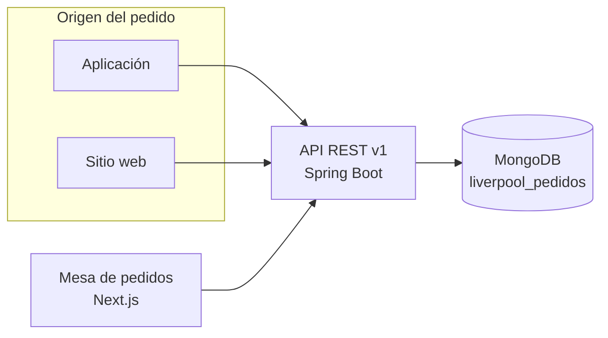

# Diseño de la mesa de pedidos

Ejercicio técnico para el equipo de ventas de El Puerto de Liverpool. No es un producto oficial de la empresa.

## Problema

Los pedidos entran por dos canales, la aplicación y el sitio web. Ventas necesita un servicio para crearlos, consultarlos, corregirlos y eliminarlos, y una mesa donde encontrar un folio o un cliente sin recorrer la lista completa.

## Arquitectura

La mesa es la interfaz del equipo de ventas. La aplicación y el sitio web no se reimplementan: el pedido guarda el canal de origen (`APP` o `WEBSITE`). En la mesa se leen como «Aplicación» y «Sitio web».

La interfaz habla con `/api` en su mismo origen. Next.js reenvía esa ruta al servicio Java, así el navegador no depende de CORS.

## Modelo

Un **cliente** vive en la colección `customers`: nombre, apellido paterno, apellido materno y correo único.

Un **pedido** referencia al cliente y, además, guarda una copia de sus datos en el momento de la compra. Si después se corrige el directorio, los pedidos ya hechos no cambian. También guarda dirección de envío, código y descripción del producto, cantidad, precio unitario, canal y estatus.

El importe no se almacena. La respuesta lo calcula como precio unitario por cantidad, con dos decimales.

El folio (`LIV-000001`) sale de un contador atómico (`findAndModify` sobre la colección `sequences`, documento `_id` `order`, campo `value`). Así dos altas simultáneas no reciben el mismo folio y no hace falta un replica set.

Cada cambio de estatus se agrega al historial embebido del pedido. Un solo documento basta: la actualización de un pedido es atómica en MongoDB.

## Búsqueda

Al guardar un pedido se construye `searchText`: folio, cliente, correo, dirección, código, descripción, canal y estatus, en minúsculas y sin acentos. El filtro y el typeahead consultan ese campo con un regex literal. Quien escribe `jose` encuentra a José, y un punto o un `+` en el término no se interpretan como operadores.

`GET /api/v1/orders/suggestions?term=` devuelve hasta ocho opciones, sin repetir el mismo cliente, correo o código. Elegir una opción manda su valor como `term` del listado.

## Capas

| Capa | Responsabilidad |
| --- | --- |
| `web` | Contratos HTTP, validación de entrada, códigos de respuesta |
| `service` | Reglas: correo único, copia del cliente, folio, historial, sugerencias |
| `repository` | MongoRepository para altas y bajas; `OrderSearch` para el filtro |
| `domain` | `Customer`, `Order`, estatus y canal |

Los errores salen en un solo formato (`status`, `error`, `message`, `details`, `path`) desde `ApiExceptionHandler`.

## API

Documentada con springdoc. Con el servicio en marcha:

- Swagger UI: <http://localhost:8080/swagger-ui.html>
- OpenAPI JSON: <http://localhost:8080/v3/api-docs>

| Método | Ruta | Uso |
| --- | --- | --- |
| POST, GET | `/api/v1/customers` | Alta y listado de clientes |
| GET, PUT, DELETE | `/api/v1/customers/{id}` | Consulta, reemplazo y baja |
| POST, GET | `/api/v1/orders` | Alta y listado (`term`, `status`, `page`, `size`) |
| GET | `/api/v1/orders/suggestions?term=` | Typeahead, desde dos caracteres |
| GET, PUT, DELETE | `/api/v1/orders/{id}` | Detalle, corrección y baja |
| PATCH | `/api/v1/orders/{id}/status` | Cambio de estatus |
| GET | `/api/v1/health` | Servicio y ping a MongoDB |

No se elimina un cliente que todavía tiene pedidos: la API responde `409`.

## Interfaz

Dos pantallas.

1. **Mesa** (`/`). Lista de pedidos, typeahead, filtro por estatus y altas de cliente y de pedido en la misma vista.
2. **Ficha** (`/orders/{id}`). Los tres grupos del encargo —cliente, entrega y pedido—, el historial, el cambio de estatus, la corrección y la baja.

En ancho estrecho la tabla se sustituye por fichas. Las acciones siguen en la página.

La frase de vacío es una sola constante, `EMPTY_SEARCH_MESSAGE`, y la usan el typeahead y la lista:

> No se tienen resultados que coincidan con los criterios de búsqueda.

## Qué quedó fuera

No hay autenticación. La mesa pública está en <https://liverpool.dvrd.io>. MongoDB y el puerto del API no se publican; la mesa reenvía `/api` en su mismo origen, así que quien tiene la dirección puede crear y cambiar pedidos. Corregir o eliminar un cliente se hace por el API. La mesa solo da de alta clientes y gestiona el pedido completo.
